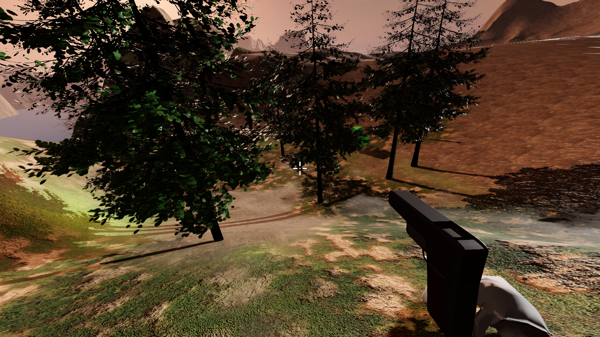

# 

## Overview
**Zom4** is a 3D semi-open-world survival horror survival game built with **Godot 4** and **Blender**. 

Stranded on a deserted archipelago at the outbreak of a zombie apocalypse, you are the sole survivor left behind. To stay alive, you must drive, race, and freely explore four distinct islands—scavenging essential supplies, navigating hostile terrain, and surviving the undead.

---

## 🎥 Game Preview

<!-- Drop your screen recording (.mp4 / .gif) or screenshots below! -->
> 📌 *Add your gameplay video or screenshots here:*
> 
> 

---

## Key Features
* **Four Islands:** Explore a semi-open world divided into four distinct islands, each featuring its own environmental hazards, special abilities/mechanics, and escalating difficulty levels.
* **Free-Roam Driving:** Traverse the islands behind the wheel, driving across varied terrain to outrun threats and reach supply zones.
* **Survival Horror Mechanics:** Scavenge for critical amenities and resources in an eerie, abandoned world overrun by zombies.
* **Custom 3D Assets:** Every 3D model in the game is crafted from scratch in Blender by the maintainer, paired with open-source and royalty-free textures.

---

##  Tech Stack
* **Game Engine:** [Godot Engine 4.x (.NET / Mono)](https://godotengine.org/)
* **Programming Languages:** GDScript & C#
* **3D Modeling & UV Unwrapping:** [Blender](https://www.blender.org/)
* **Textures:** Open-source & Royalty-Free PBR / Pixel / Image Textures

---

## Project Status
The game is currently underdevelopment and actively maintained by a solo developer and also contributions from the community are welcomed. 
- [✓] Core vehicle controller & movement mechanics
- [✓] Custom 3D environment & asset creation in Blender
- [✓] Island layout & terrain setup
- [✓] Enemy AI baseline and with character models
- [x] Full survival scavenging loop & inventory system
- [x] Polishing zombie AI encounters & island bosses/abilities